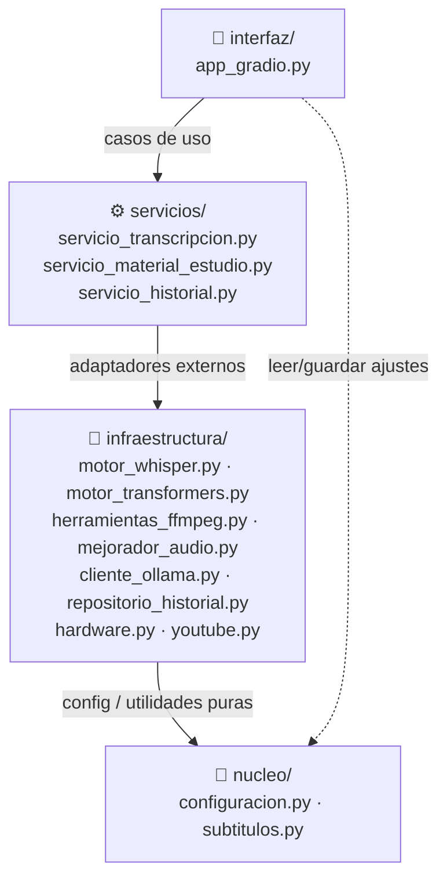
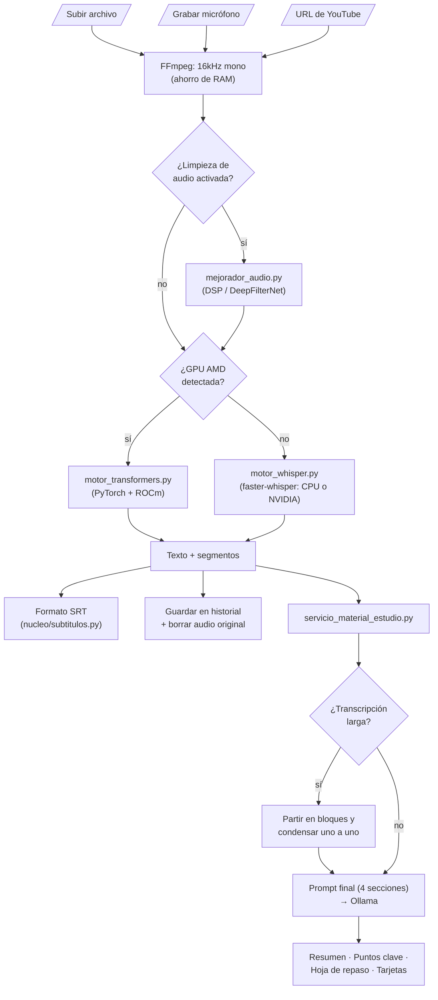

# 🎙️ Universal Local Transcriber Pro

  

*(For the **English** version of this README, scroll down / Para la versión en **Inglés**, desplázate hacia abajo).*

Una aplicación de Inteligencia Artificial alojada localmente, diseñada para transcribir audio y generar material de estudio (resumen y puntos clave) a partir de clases grabadas — pensada para correr en hardware modesto, **sin GPU**, y **completamente offline**.

## 🚀 Características Principales

* **Transcripción con `faster-whisper` (CTranslate2)**: Motor único, liviano y cuantizado (tiny/base/small) — corre en CPU en tiempo razonable, sin depender de GPU.
* **Filtrado de Audio Avanzado**: Kit de limpieza de ruido integrado por software para purificar el audio antes de transcribir (Filtros auto-ajustables Wiener, Inteligencia Artificial DeepFilterNet local, ecualización y compresores dinámicos).
* **Historial de Transcripciones**: Base de datos SQLite integrada que mantiene un historial visual persistente de sesiones anteriores, interconectada con un sistema de carpetas `outputs/` para descargar tus `.txt` y `.srt` generados al instante desde la interfaz.
* **Post-Procesamiento con LLM**: Conexión directa con *OLLAMA* para generar resumen y puntos clave de la clase con modelos textuales puramente locales.

## ⚙️ Instalación

### 1. Requisitos de FFMPEG (Necesario para procesar audio)
* **Windows**: Descarga el ejecutable desde [Gyan.dev](https://www.gyan.dev/ffmpeg/builds/) y agrégalo a tus variables de entorno, o usa Chocolatey: `choco install ffmpeg`.
* **Mac OS**: Usa Homebrew: `brew install ffmpeg`
* **Linux (Ubuntu)**: `sudo apt install ffmpeg`

### 2. Configuración del Entorno Python (Recomendado)
Crea un entorno virtual y actívalo:
```bash
python -m venv transcriptor-env
# En Linux/Mac:
source transcriptor-env/bin/activate
# En Windows (Powershell):
.\transcriptor-env\Scripts\Activate.ps1
```

### 3. Instalación de Dependencias
El hardware objetivo de este proyecto no tiene GPU — `faster-whisper` corre bien en CPU con modelos livianos (tiny/base/small). La app detecta el hardware disponible y elige el motor sola, sin configuración manual:

* **Sin GPU / GPU NVIDIA**: instala PyTorch genérico y el resto de dependencias:
  ```bash
  pip install torch torchaudio
  pip install -r requirements.txt
  ```
  *(Si hay una GPU NVIDIA disponible, la app la detecta y usa automáticamente vía `faster-whisper` — no es un requisito).*

* **GPU AMD (ROCm, solo Linux)**: `faster-whisper` no puede usar GPUs AMD (CTranslate2 no soporta ROCm), así que la app cae automáticamente a `transformers` + PyTorch, que sí soporta ROCm. Instala el build de PyTorch para ROCm en vez del genérico (ajusta la versión de ROCm a la que tengas instalada, ej. `rocm6.1`):
  ```bash
  pip install torch torchaudio --index-url https://download.pytorch.org/whl/rocm6.1
  pip install -r requirements.txt
  ```
  ROCm no está soportado en Windows — ahí una GPU AMD simplemente cae a `faster-whisper` en CPU.

## 🖥️ Uso

Simplemente ejecuta la raíz:
```bash
python app.py
```
Abre tu navegador web en la URL Local proporcionada por la consola (generalmente `http://127.0.0.1:7862`).

## 🐳 Despliegue con Docker (opción alternativa)

Instalación con un solo comando, incluyendo un **cluster local de Ollama** (varias instancias en la misma máquina, balanceadas con nginx) para acelerar la generación de material de estudio cuando hay varias clases en cola. **Requiere Docker instalado** (en Windows implica admin + WSL2/Hyper-V) — es una alternativa para colegios con soporte técnico, no reemplaza el objetivo de instalación portátil sin admin (pendiente vía PyInstaller).

Antes del primer arranque, crea los archivos de datos vacíos (si no existen, Docker los monta como carpetas en vez de archivos):
```bash
touch transcriptions_history.db transcriber_config.json
mkdir -p outputs downloads
docker compose up --build
```
Esto levanta:
- `app`: la interfaz Gradio, publicada en `http://localhost:7862`.
- `ollama-1` / `ollama-2`: dos instancias de Ollama (ajustable agregando/quitando bloques en `docker-compose.yml` + `nginx-ollama.conf`, según la RAM disponible — cada instancia carga su propio modelo en memoria), con el modelo configurado descargándose automáticamente al primer arranque.
- `ollama-lb`: balanceador nginx que reparte las peticiones entre las instancias de Ollama.

Para usar un modelo distinto al default (`llama3`):
```bash
OLLAMA_MODEL=qwen2.5:7b docker compose up --build
```


Cada instancia de Ollama es un contenedor completo con su propio modelo cargado en memoria — el balanceador solo reparte peticiones entre las que ya están levantadas, no coordina memoria entre ellas. Hoy este cluster no acelera nada por sí solo (la app procesa una clase a la vez, sin cola concurrente) — es capacidad lista para cuando exista la cola de procesamiento EDF planificada en `CLAUDE.md`.

### 📂 Arquitectura en Capas

El proyecto está organizado en capas, cada una dependiendo solo de las de abajo (`interfaz → servicios → infraestructura → nucleo`). Los nombres de carpetas y archivos están en español — el proyecto es para colegios chilenos, no tiene sentido que el código base asuma inglés:



- `app.py`: Entry point delgado — arranca la app Gradio.
- `interfaz/`: Interfaz Gradio (`app_gradio.py`). Solo llama a `servicios/` (y a `nucleo/configuracion.py` para leer/guardar preferencias).
- `servicios/`: Casos de uso de la aplicación — `servicio_transcripcion.py` (orquesta FFmpeg + limpieza de audio + faster-whisper + SRT), `servicio_material_estudio.py` (prompt de estudio + parsing de la respuesta de Ollama), `servicio_historial.py` (guardar/listar historial).
- `infraestructura/`: Adaptadores a sistemas externos — `motor_whisper.py` (faster-whisper, motor por defecto), `motor_transformers.py` (motor alternativo, solo se activa en GPU AMD/ROCm), `hardware.py` (detección de vendor de GPU), `herramientas_ffmpeg.py`, `mejorador_audio.py` (DSP), `cliente_ollama.py` (HTTP a Ollama), `repositorio_historial.py` (SQLite), `youtube.py` (yt-dlp).
- `nucleo/`: Configuración (`configuracion.py`) y utilidades puras sin dependencias externas (`subtitulos.py`).
- `/outputs`: La carpeta segura generada automáticamente adonde irán a parar todos tus registros `.srt` y `.txt`.

### 🔄 Flujo de Procesamiento

De principio a fin: cómo una grabación de clase se convierte en transcripción y material de estudio.



---

<br><br>

# 🎙️ Universal Local Transcriber Pro (English)

A locally-hosted Artificial Intelligence application designed to transcribe audio and generate study material (summary and key points) from recorded classes — built to run on modest hardware, **with no GPU**, **entirely offline**.

## 🚀 Features

* **Transcription with `faster-whisper` (CTranslate2)**: Single, lightweight, quantized engine (tiny/base/small) — runs on CPU in reasonable time, no GPU dependency.
* **Advanced DSP Audio Filtering**: Integrated audio toolkit to clean noisy input before transcription (Wiener filters, active local DeepFilterNet AI, Voice Boost equalization, and Dynamic Compressors).
* **Transcription History**: Embedded SQLite database maintaining a persistent UI visual history of previous sessions, interconnected with an `outputs/` folder system for instant `.txt` and `.srt` file extraction right from the app window.
* **LLM Post-Processing**: Direct OLLAMA integration to generate a class summary and key points using local text models.

## ⚙️ Installation

### 1. FFMPEG Requirements (Mandatory for audio processing)
* **Windows**: Download the binary from [Gyan.dev](https://www.gyan.dev/ffmpeg/builds/) and add it to your PATH variables, or use Chocolatey: `choco install ffmpeg`.
* **Mac OS**: Use Homebrew: `brew install ffmpeg`
* **Linux (Ubuntu)**: `sudo apt install ffmpeg`

### 2. Python Environment Setup (Highly Recommended)
Create and activate a virtual environment:
```bash
python -m venv transcriptor-env
# On Linux/Mac:
source transcriptor-env/bin/activate
# On Windows (Powershell):
.\transcriptor-env\Scripts\Activate.ps1
```

### 3. Install Dependencies
The target hardware for this project has no GPU — `faster-whisper` runs well on CPU with lightweight models (tiny/base/small). The app detects the available hardware and picks the engine on its own, no manual configuration needed:

* **No GPU / NVIDIA GPU**: install generic PyTorch and the rest of the dependencies:
  ```bash
  pip install torch torchaudio
  pip install -r requirements.txt
  ```
  *(If an NVIDIA GPU happens to be available, the app detects and uses it automatically via `faster-whisper` — it's a bonus, not a requirement).*

* **AMD GPU (ROCm, Linux only)**: `faster-whisper` can't use AMD GPUs (CTranslate2 has no ROCm support), so the app automatically falls back to `transformers` + PyTorch, which does support ROCm. Install the ROCm PyTorch build instead of the generic one (match the ROCm version you have installed, e.g. `rocm6.1`):
  ```bash
  pip install torch torchaudio --index-url https://download.pytorch.org/whl/rocm6.1
  pip install -r requirements.txt
  ```
  ROCm isn't supported on Windows — there, an AMD GPU simply falls back to `faster-whisper` on CPU.

## 🖥️ Usage

Simply run:
```bash
python app.py
```
And open your browser at the localized Local URL provided in the terminal (usually `http://127.0.0.1:7862`).

## 🐳 Docker Deployment (alternative option)

One-command install, including a **local Ollama cluster** (several instances on the same machine, load-balanced with nginx) to speed up study material generation when multiple classes are queued. **Requires Docker installed** (on Windows that means admin + WSL2/Hyper-V) — this is an alternative for schools with technical support, it doesn't replace the no-admin portable install goal (still pending via PyInstaller).

Before the first run, create the empty data files (if missing, Docker mounts them as directories instead of files):
```bash
touch transcriptions_history.db transcriber_config.json
mkdir -p outputs downloads
docker compose up --build
```
This brings up:
- `app`: the Gradio interface, published at `http://localhost:7862`.
- `ollama-1` / `ollama-2`: two Ollama instances (adjustable by adding/removing blocks in `docker-compose.yml` + `nginx-ollama.conf`, based on available RAM — each instance loads its own model in memory), with the configured model auto-downloading on first boot.
- `ollama-lb`: nginx load balancer distributing requests across the Ollama instances.

To use a different model than the default (`llama3`):
```bash
OLLAMA_MODEL=qwen2.5:7b docker compose up --build
```

*(See the deployment diagram in the Spanish section above — it's not duplicated here since the diagrams are language-agnostic: the boxes are labeled with the actual Spanish file/folder names used in the codebase.)*

### 📂 Layered Architecture

The project is organized in layers, each depending only on the ones below it (`interfaz → servicios → infraestructura → nucleo`). Folder and file names are in Spanish — this project targets Chilean schools, so an English-first codebase doesn't make sense here. *(See the architecture and processing-flow diagrams in the Spanish section above — same reasoning: the diagrams show the actual Spanish file/folder names, so they're not duplicated here.)*

- `app.py`: Thin entry point — boots the Gradio app.
- `interfaz/` ("interface"): Gradio interface (`app_gradio.py`). Only calls into `servicios/` (and `nucleo/configuracion.py` to read/write settings).
- `servicios/` ("services"): Application use cases — `servicio_transcripcion.py` (orchestrates FFmpeg + audio cleanup + faster-whisper + SRT), `servicio_material_estudio.py` (study prompt + parsing the Ollama response), `servicio_historial.py` (save/list history).
- `infraestructura/` ("infrastructure"): Adapters to external systems — `motor_whisper.py` (faster-whisper, default engine), `motor_transformers.py` (alternate engine, only activates on AMD/ROCm GPUs), `hardware.py` (GPU vendor detection), `herramientas_ffmpeg.py`, `mejorador_audio.py` (DSP), `cliente_ollama.py` (HTTP to Ollama), `repositorio_historial.py` (SQLite), `youtube.py` (yt-dlp).
- `nucleo/` ("core"): Settings (`configuracion.py`) and dependency-free pure utilities (`subtitulos.py`).
- `/outputs`: The secure output folder generated automatically to collect resulting `.srt` and `.txt`.

---
*Created for fast, strict, and fully local privacy-based automated pipelines.*
