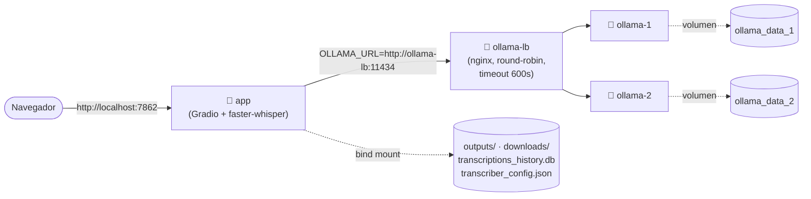
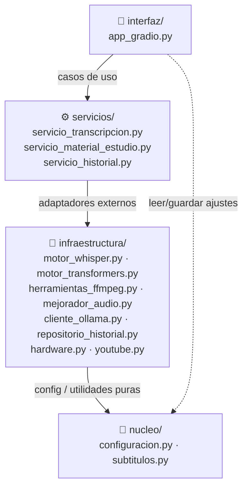
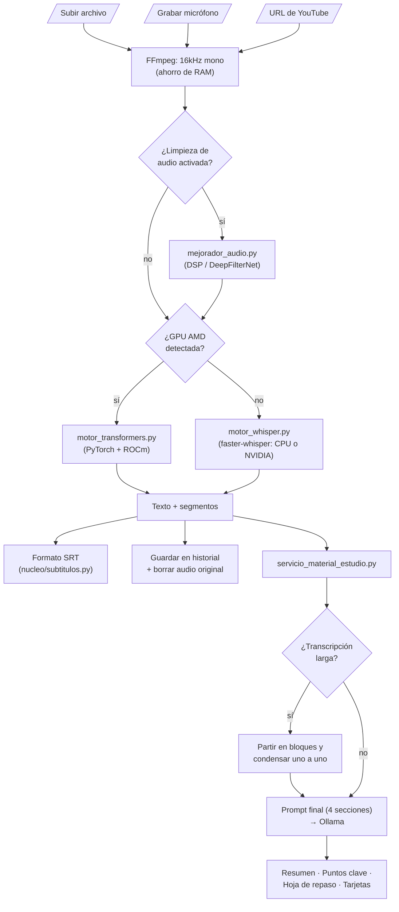

# 🎙️ Universal Local Transcriber Pro

  

Una aplicación de Inteligencia Artificial alojada localmente, diseñada para transcribir audio y generar material de estudio (resumen y puntos clave) a partir de clases grabadas — pensada para correr en hardware modesto, **sin GPU**, y **completamente offline**.

## 🚀 Características Principales

* **Transcripción con `faster-whisper` (CTranslate2)**: Motor único, liviano y cuantizado (tiny/base/small) — corre en CPU en tiempo razonable, sin depender de GPU.
* **Filtrado de Audio Avanzado**: Kit de limpieza de ruido integrado por software para purificar el audio antes de transcribir (Filtros auto-ajustables Wiener, Inteligencia Artificial DeepFilterNet local, ecualización y compresores dinámicos).
* **Historial de Transcripciones**: Base de datos SQLite integrada que mantiene un historial visual persistente de sesiones anteriores, interconectada con un sistema de carpetas `outputs/` para descargar tus `.txt` y `.srt` generados al instante desde la interfaz.
* **Post-Procesamiento con LLM**: Conexión directa con *OLLAMA* para generar resumen y puntos clave de la clase con modelos textuales puramente locales.

## ⚙️ Instalación

### 1. Requisitos de FFMPEG (Necesario para procesar audio)
* **Windows**: Descarga el ejecutable desde [Gyan.dev](https://www.gyan.dev/ffmpeg/builds/) y agrégalo a tus variables de entorno, o usa Chocolatey: `choco install ffmpeg`.
* **Mac OS**: Usa Homebrew: `brew install ffmpeg`
* **Linux (Ubuntu)**: `sudo apt install ffmpeg`

### 2. Configuración del Entorno Python (Recomendado)
Crea un entorno virtual y actívalo:
```bash
python -m venv transcriptor-env
# En Linux/Mac:
source transcriptor-env/bin/activate
# En Windows (Powershell):
.\transcriptor-env\Scripts\Activate.ps1
```

### 3. Instalación de Dependencias
El hardware objetivo de este proyecto no tiene GPU — `faster-whisper` corre bien en CPU con modelos livianos (tiny/base/small). La app detecta el hardware disponible y elige el motor sola, sin configuración manual:

* **Sin GPU**: instala PyTorch genérico (CPU) y el resto de dependencias:
  ```bash
  pip install torch==2.13.0 torchaudio==2.11.0
  pip install -r requirements.txt
  ```

* **GPU NVIDIA**: `faster-whisper` (CTranslate2) está compilado contra CUDA 12 — instala PyTorch fijado a ese índice, **no** el genérico (que hoy resuelve a CUDA 13 y causa un error `libcublas.so.12 not found` al transcribir en GPU). `torch` y `torchaudio` deben instalarse del mismo índice en el mismo comando — si quedan de versiones de CUDA distintas, `torchaudio` no encuentra sus propias librerías:
  ```bash
  pip install torch==2.13.0 torchaudio==2.11.0 --index-url https://download.pytorch.org/whl/cu126
  pip install -r requirements.txt
  ```

* **GPU AMD (ROCm, solo Linux)**: `faster-whisper` no puede usar GPUs AMD (CTranslate2 no soporta ROCm), así que la app cae automáticamente a `transformers` + PyTorch, que sí soporta ROCm. Instala el build de PyTorch para ROCm en vez del genérico (ajusta la versión de ROCm a la que tengas instalada, ej. `rocm6.1`):
  ```bash
  pip install torch==2.6.0 torchaudio==2.6.0 --index-url https://download.pytorch.org/whl/rocm6.1
  pip install -r requirements.txt
  ```
  ROCm no está soportado en Windows — ahí una GPU AMD simplemente cae a `faster-whisper` en CPU.

## 🖥️ Uso

Simplemente ejecuta la raíz:
```bash
python app.py
```
Abre tu navegador web en la URL Local proporcionada por la consola (generalmente `http://127.0.0.1:7862`).

## 🐳 Despliegue con Docker (opción alternativa)

Instalación con un solo comando, incluyendo un **cluster local de Ollama** (varias instancias en la misma máquina, balanceadas con nginx) para acelerar la generación de material de estudio cuando hay varias clases en cola. **Requiere Docker instalado** (en Windows implica admin + WSL2/Hyper-V) — es una alternativa para colegios con soporte técnico, no reemplaza el objetivo de instalación portátil sin admin (pendiente vía PyInstaller).

Todos los archivos de Docker viven en `docker/` (comandos siempre desde la raíz del repo). Antes del primer arranque, crea los archivos de datos vacíos (si no existen, Docker los monta como carpetas en vez de archivos):
```bash
touch transcriptions_history.db transcriber_config.json
mkdir -p outputs downloads
docker compose -f docker/docker-compose.yml up --build
```
Esto levanta:
- `app`: la interfaz Gradio, publicada en `http://localhost:7862`.
- `ollama-1` / `ollama-2`: dos instancias de Ollama (ajustable agregando/quitando bloques en `docker/docker-compose.yml` + `docker/nginx-ollama.conf`, según la RAM disponible — cada instancia carga su propio modelo en memoria), con el modelo configurado descargándose automáticamente al primer arranque.
- `ollama-lb`: balanceador nginx que reparte las peticiones entre las instancias de Ollama.

Por defecto se descarga `llama3.2:1b` (liviano, pensado para CPU — la app elige este mismo modelo automáticamente si `ollama_model` está en `"auto"`). Para usar otro modelo, hay que descargarlo Y decírselo a la app en Configuración:
```bash
OLLAMA_MODEL=qwen2.5:7b docker compose -f docker/docker-compose.yml up --build
```

**GPU dentro de Docker**: por defecto ningún contenedor tiene acceso a la GPU del host, aunque exista una — hay que habilitarlo explícitamente con un archivo adicional (`docker/docker-compose.gpu-nvidia.yml` o `docker/docker-compose.gpu-amd.yml`), y para NVIDIA además instalar el NVIDIA Container Toolkit en el host. Ver el detalle paso a paso en `docs/Notas_de_Instalacion.md`.



Cada instancia de Ollama es un contenedor completo con su propio modelo cargado en memoria — el balanceador solo reparte peticiones entre las que ya están levantadas, no coordina memoria entre ellas. Hoy este cluster no acelera nada por sí solo (la app procesa una clase a la vez, sin cola concurrente) — es capacidad lista para cuando exista la cola de procesamiento EDF planificada en `CLAUDE.md`.

### 📂 Arquitectura en Capas

El proyecto está organizado en capas, cada una dependiendo solo de las de abajo (`interfaz → servicios → infraestructura → nucleo`). Los nombres de carpetas y archivos están en español — el proyecto es para colegios chilenos, no tiene sentido que el código base asuma inglés:



- `app.py`: Entry point delgado — arranca la app Gradio.
- `interfaz/`: Interfaz Gradio (`app_gradio.py`). Solo llama a `servicios/` (y a `nucleo/configuracion.py` para leer/guardar preferencias).
- `servicios/`: Casos de uso de la aplicación — `servicio_transcripcion.py` (orquesta FFmpeg + limpieza de audio + faster-whisper + SRT), `servicio_material_estudio.py` (prompt de estudio + parsing de la respuesta de Ollama), `servicio_historial.py` (guardar/listar historial).
- `infraestructura/`: Adaptadores a sistemas externos — `motor_whisper.py` (faster-whisper, motor por defecto), `motor_transformers.py` (motor alternativo, solo se activa en GPU AMD/ROCm), `hardware.py` (detección de vendor de GPU), `herramientas_ffmpeg.py`, `mejorador_audio.py` (DSP), `cliente_ollama.py` (HTTP a Ollama), `repositorio_historial.py` (SQLite), `youtube.py` (yt-dlp).
- `nucleo/`: Configuración (`configuracion.py`) y utilidades puras sin dependencias externas (`subtitulos.py`).
- `/outputs`: La carpeta segura generada automáticamente adonde irán a parar todos tus registros `.srt` y `.txt`.

### 🔄 Flujo de Procesamiento

De principio a fin: cómo una grabación de clase se convierte en transcripción y material de estudio.



---
*Hecho para clases privadas, 100% locales y automatizadas.*
