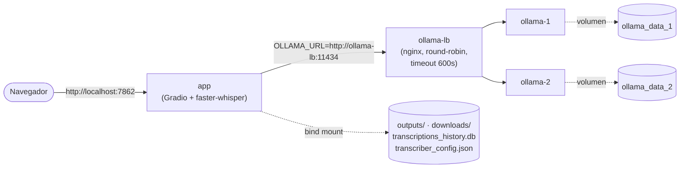
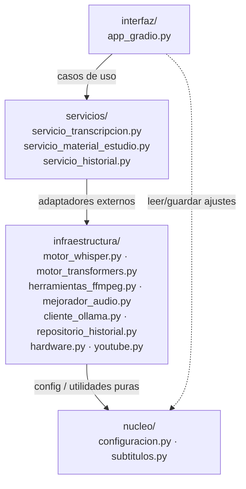
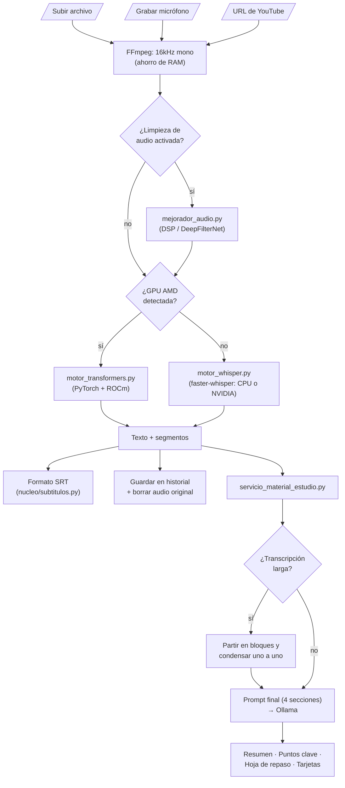

# ClaseAIdia (Universal Local Transcriber)

  

Una aplicación de Inteligencia Artificial alojada localmente, diseñada para transcribir audio y generar material de estudio (resumen y puntos clave) a partir de clases grabadas — pensada para correr en hardware modesto, **sin GPU**, y **completamente offline**.

## Características Principales

* **Transcripción con `faster-whisper` (CTranslate2)**: Motor único, liviano y cuantizado (tiny/base/small) — corre en CPU en tiempo razonable, sin depender de GPU.
* **Filtrado de Audio Avanzado**: Kit de limpieza de ruido integrado por software para purificar el audio antes de transcribir (Filtros auto-ajustables Wiener, Inteligencia Artificial DeepFilterNet local, ecualización y compresores dinámicos).
* **Historial de Transcripciones**: Base de datos SQLite integrada que mantiene un historial visual persistente de sesiones anteriores, interconectada con un sistema de carpetas `outputs/` para descargar tus `.txt` y `.srt` generados al instante desde la interfaz.
* **Post-Procesamiento con LLM**: Conexión directa con *OLLAMA* para generar resumen y puntos clave de la clase con modelos textuales puramente locales.

## Aviso para el colegio: privacidad y condiciones de uso

**Al instalar y usar ClaseAIdia, el colegio acepta estas condiciones.** Como el sistema corre en el servidor del propio colegio, es el colegio quien administra los datos y responde por ellos ante sus alumnos y apoderados.

- **Qué se guarda:** nombre, RUT y curso de cada persona; el PIN de los alumnos y la contraseña del personal solo como hash irreversible (nadie puede leerlos); por cada clase, la transcripción en texto y el material de estudio generado; el horario.
- **Qué no se guarda:** las fotos de la pizarra que saca el profesor tampoco se guardan: se leen con IA en el propio servidor y la imagen se borra al instante (solo queda el texto leído). El audio nunca se almacena de forma permanente: se borra al terminar de procesarse. Si el procesamiento falla, se conserva en el servidor solo mientras queden reintentos automáticos (a los 5, 15 y 45 minutos; unas 65 min como máximo) y se borra al tener éxito o al agotarse los intentos. No hay cookies de seguimiento, publicidad ni analíticas de terceros. Todo el procesamiento de IA ocurre en el servidor del colegio; nada se envía a servicios de IA en la nube.
- **Quién ve qué:** cada alumno ve el material de su propio curso; cada profesor, las clases que dicta; el UTP administra cursos, horarios y personal. Un colegio no ve los datos de otro.
- **Menores de edad:** antes de usar la plataforma con alumnos menores, el colegio debe contar con el **consentimiento informado de sus apoderados**.
- **Material generado por IA:** puede contener errores. Si el profesor no lo revisa en el plazo (24 h por defecto), se muestra a los alumnos marcado como "Sin revisar". El colegio debe informar a profesores y alumnos de esto.
- **Derechos de las personas:** acceso, corrección y eliminación de sus datos (en menores, a través del apoderado). **El colegio define cuánto tiempo conserva las transcripciones** y atiende estas solicitudes.
- **Grabación de clases:** solo con conocimiento del profesor y del curso.
- **Contacto del equipo:** tambotconpatas@proton.me (se muestra en las páginas de privacidad y términos; se cambia en `frontend/.env.production`, variable `VITE_CONTACTO`).

Estas mismas condiciones aparecen dentro de la aplicación (`#/privacidad` y `#/terminos`, enlazadas en el pie de cada pantalla) como respaldo y para consulta de alumnos y apoderados; lo que vale es este aviso. El software se entrega como prototipo académico, sin garantía.

## Instalación

### 0. Versión de Python (3.12 o superior)
Requiere **Python 3.12 o superior** (probado en 3.12 y 3.14). No hace falta Conda ni Anaconda — con el Python normal de [python.org](https://www.python.org/downloads/) (o `winget`) alcanza; el módulo `venv` que se usa abajo es parte de la librería estándar. Versiones anteriores a 3.12 no sirven: `numpy`, `scipy` y `librosa` exigen 3.12 como mínimo.
> **Windows**: `winget install --id Python.Python.3.14 -e --scope user` instala Python sin admin. Si ya tienes otras versiones instaladas, usa `py -3.14` (o la que quieras) en vez de `python` a secas en el paso 2 para apuntar a la correcta.

### 1. Requisitos de FFMPEG (Necesario para procesar audio)
* **Windows**: `winget install Gyan.FFmpeg` o descarga desde [Gyan.dev](https://www.gyan.dev/ffmpeg/builds/) y agrégalo a tu PATH.
* **Mac OS**: Usa Homebrew: `brew install ffmpeg`
* **Linux (Ubuntu)**: `sudo apt install ffmpeg`

### 2. Configuración del Entorno Python
Crea un entorno virtual con `venv` (viene incluido con Python, no requiere instalar nada más) y actívalo:
```bash
python3 -m venv transcriptor-env
# En Linux/Mac:
source transcriptor-env/bin/activate
# En Windows (Powershell) — usa "py -3.14" (o tu versión) si tienes más de una versión de Python instalada:
py -3.14 -m venv transcriptor-env
.\transcriptor-env\Scripts\Activate.ps1
```
*(Si ya usas Conda y prefieres seguir con eso, `conda create -n transcriptor-env python=3.14 -y` funciona igual de bien — ver la [Guía de Instalación en Windows](docs/Guia_Instalacion_Windows.md) para esa variante paso a paso.)*

### 3. Instalación de Dependencias
El hardware objetivo de este proyecto no tiene GPU — `faster-whisper` corre bien en CPU con modelos livianos (tiny/base/small). La app detecta el hardware disponible y elige el motor sola, sin configuración manual:

* **Sin GPU**: instala PyTorch desde el índice **`cpu`** explícito — el índice genérico de PyPI también resuelve a una build con CUDA 13 empaquetado (~1.5GB de paquetes NVIDIA de más, confirmado 2026-09-03) aunque no haya GPU en el equipo:
  ```bash
  pip install torch==2.14.1 torchaudio==2.11.0 --index-url https://download.pytorch.org/whl/cpu
  pip install -r requirements.txt
  ```

* **GPU NVIDIA**: `faster-whisper` (CTranslate2) está compilado contra CUDA 12 — instala PyTorch fijado a ese índice, **no** el genérico (que hoy resuelve a CUDA 13 y causa un error `libcublas.so.12 not found` al transcribir en GPU). `torch` y `torchaudio` deben instalarse del mismo índice en el mismo comando — si quedan de versiones de CUDA distintas, `torchaudio` no encuentra sus propias librerías:
  ```bash
  pip install torch==2.14.1 torchaudio==2.11.0 --index-url https://download.pytorch.org/whl/cu126
  pip install -r requirements.txt
  ```

* **GPU AMD (ROCm, solo Linux)**: `faster-whisper` no puede usar GPUs AMD (CTranslate2 no soporta ROCm), así que la app cae automáticamente a `transformers` + PyTorch, que sí soporta ROCm. Instala el build de PyTorch para ROCm en vez del genérico (ajusta la versión de ROCm a la que tengas instalada, ej. `rocm6.1`):
  ```bash
  pip install torch==2.6.0 torchaudio==2.6.0 --index-url https://download.pytorch.org/whl/rocm6.1
  pip install -r requirements.txt
  ```
  ROCm no está soportado en Windows — ahí una GPU AMD simplemente cae a `faster-whisper` en CPU.

### 4. Opcional: leer la pizarra con una foto

**Está apagada por defecto: cada colegio elige si la quiere** (ver «Rendimiento medido» más abajo para decidir), y lo decide **el UTP dentro de la aplicación**, en «Ajustes» (menú de la izquierda). No hay que editar archivos ni escribir comandos: la aplicación se reparte portable y el colegio no tiene por qué saber hacerlo. La transcripción y el resumen funcionan igual sin ella.

En «Ajustes» el UTP ve lo que necesita para decidir y lo deja listo desde ahí:

- **Memoria del equipo**: dice cuánta tiene y si alcanza (se recomiendan 16 GB; con menos, lo normal es que las fotos se salten solas al procesar y la clase se procese igual, sin ellas).
- **Programa de IA (Ollama)**: si está funcionando en el equipo (Ollama es el único programa que hay que instalar aparte, desde ollama.com).
- **Modelo de lectura de imágenes** (3,2 GB de disco): si falta, un botón «Descargar el modelo» lo baja con una barra de avance. Hace falta internet, una sola vez.
- El interruptor «Permitir fotos de la pizarra». Apagado, el botón no aparece y el servidor rechaza las fotos.

Con ella activada, el profesor puede sacar fotos de la pizarra con su celular durante la clase («Foto de la pizarra» en la pantalla de grabar); un modelo de visión las lee después de la clase y suma lo escrito al material (la imagen se borra apenas se lee). Necesita unos **4,5 GB de memoria libre** además de lo que ya usa el sistema: en un equipo de 16 GB sobra, en uno de 8 GB lo normal es que no alcance. Si el modelo no está instalado, las fotos quedan con un aviso y la clase se procesa igual. Lee bien letra clara, listas y esquemas; en matemática escrita a mano conserva la estructura pero **puede cambiar cifras**, por eso el profesor revisa y corrige antes de aprobar.

### 5. Opcional: modo de limpieza de audio "DeepFilterNet"
`requirements.txt` no incluye `deepfilternet` a propósito — su dependencia `deepfilterlib` compila una extensión nativa en Rust y romper esto rompería la instalación de *todo* el resto de dependencias si Cargo no está presente (confirmado 2026-09-03). Sin este paso, la app funciona igual con los demás modos de limpieza de audio (DSP/MMSE). Para tener el modo `deepfilter` (máxima calidad) también:
```bash
# Requiere Rust + Cargo instalados primero: https://rustup.rs/ (no necesita sudo)
pip install -r requirements-deepfilter.txt
```

## Rendimiento medido (solo CPU, sin GPU)

Lo que sigue se midió con la clase real de 92 minutos (12.500 palabras) y 6 fotos reales de pizarra, por el mismo flujo que usa la aplicación, **solo con CPU**: Ollama y Whisper sin GPU y limitados a los núcleos indicados (2026-10-02). **Las dos partes se miden y se deciden por separado**: lo primero es el núcleo de la aplicación; lo segundo es opcional.

*Advertencia sobre estos números*: se midieron en un procesador Intel Core i5-13420H (de 13.ª generación, rápido). Un PC escolar típico, más antiguo, puede tardar **el doble**. Dos corridas del mismo perfil de 4 núcleos dieron 13,2 y 16,9 minutos de transcripción: cuenten con una variación de un cuarto.

### A. Núcleo: transcripción y resumen (obligatorio)

Una clase de 92 minutos, de principio a fin (la clase se procesa sola después de terminar; una clase de 45 minutos tarda aproximadamente la mitad):

| Equipo (sin GPU) | Transcripción (Whisper `small`) | Resumen con `llama3.2:1b` (el que se usa sin GPU) | **Total con 1B** | Resumen con `llama3.2:3b` (mejor, más pesado) | Total con 3B |
|---|---|---|---|---|---|
| 4 núcleos rápidos | 16,9 min | 2,4 min | **19,3 min** | 17,5 min | 34,4 min |
| 8 núcleos (4 rápidos + 4 lentos) | 22,3 min | 2,3 min | **24,6 min** | 11,6 min | 33,9 min |

- **Memoria**: la transcripción llega a 2,0 GB; Ollama usa unos 1,6 GB con el modelo de 1B y unos 4,8 GB con el de 3B. Se carga un modelo a la vez y se suelta, así que 8 GB bastan con el de 1B; con el de 3B conviene tener 16 GB.
- *Lo del 8 núcleos*: el procesador de las pruebas mezcla 4 núcleos rápidos con 4 lentos, y la transcripción esperaba a los lentos; un PC con 8 núcleos iguales debería ser más rápido que el de 4. No se midió uno.
- Una jornada con varias clases se procesa de a una, en orden: el procesamiento es de varios minutos por clase, no de horas, así que cabe de sobra entre una clase y la siguiente o durante la noche. Esto último es una estimación (no se midió una jornada completa de clases de 45 minutos).

### B. Opcional: fotos de la pizarra

Seis fotos reales (tarea con letra clara, mapa conceptual en pantalla, pizarra de cálculo, cuaderno de límites, direcciones IP, lista de librerías), cada una leída por el modelo de visión `qwen2.5vl:3b`:

| Equipo (sin GPU) | Primera foto (con la carga del modelo) | Las demás | Las 6 fotos | Memoria del modelo |
|---|---|---|---|---|
| 4 núcleos rápidos | 14 s | de 8 a 47 s (mediana 34 s) | **2,7 min** | 3,4 GB |
| 8 núcleos (4 rápidos + 4 lentos) | 19 s | de 8 a 49 s (mediana 42 s) | **3,1 min** | 3,4 GB |

- Se suma **a la clase, después de transcribir**: una clase con 10 fotos tarda unos 6 minutos más. Más núcleos no la aceleran (leer una imagen depende de la velocidad de la memoria, no de cuántos núcleos haya).
- Pide **3,2 GB de disco** (el modelo, que el UTP baja desde «Ajustes») y unos **4,5 GB de memoria libre** además de lo que ya usa el sistema: con 16 GB sobra; con 8 GB casi seguro que no alcanza, y las fotos se saltan solas (la clase se procesa igual, sin ellas).
- Calidad (ver `QA.md`): lee bien letra clara, listas y esquemas; en matemática escrita a mano **puede cambiar cifras**, por eso el profesor revisa y corrige antes de aprobar. Con la pizarra de cálculo más densa el modelo a veces se repite; la aplicación lo limpia y reintenta sola (en estas seis lecturas no hizo falta).

**Para decidir**: si el equipo del colegio tiene 8 GB, o el profesorado no va a usar la pizarra de esa manera, déjenla apagada (es lo normal: no se descarga nada más ni se gasta tiempo). Si tiene 16 GB y quieren que lo escrito en la pizarra llegue al material, el UTP la activa en «Ajustes».

## Uso

Simplemente ejecuta la raíz:
```bash
python app.py
```
Abre tu navegador web en la URL Local proporcionada por la consola (generalmente `http://127.0.0.1:7862`).

### Backend (API FastAPI)

```bash
cp .env.example .env    # y completar JWT_SECRET_KEY (el archivo explica cómo generarla)
alembic upgrade head    # crea/actualiza escuela.db (o la base de DATABASE_URL, si está definida)
uvicorn api:app --port 8000
```
La primera vez, el servidor no tiene colegio: se crea junto con su primer UTP con `POST /auth/setup` (se puede hacer desde `http://127.0.0.1:8000/docs`). Después de eso ese endpoint se cierra solo — hacerlo **antes** de exponer el servidor a internet.
Sin `JWT_SECRET_KEY` la API arranca igual, pero con una clave temporal: todas las sesiones se cierran en cada reinicio.

**Grabar clases** (pestaña «Grabar» del profesor): solo desde la red del colegio. Hay dos formas, las dos válidas: un **PC de la sala graba** (abre la app, entra a «Grabar» y pulsa «Grabar con este equipo»; el celular del profesor solo controla), o el **celular graba** él mismo. Para grabar con el celular la app tiene que abrirse por **https** (o `localhost`): los navegadores no dan el micrófono desde `http://192.168...`; en un PC de la sala que abra la app con `localhost` no hay problema. Para abrirla por https en la red del colegio:
```bash
python -m scripts.generar_certificado            # crea certs/cert.pem y certs/key.pem (certs/ no se sube a git)
uvicorn api:app --host 0.0.0.0 --port 8443 --ssl-keyfile certs/key.pem --ssl-certfile certs/cert.pem
cd frontend && npm run dev:https                  # en desarrollo; mismo certificado
```
El certificado es propio: la primera vez, cada celular o PC muestra «conexión no privada» y hay que tocar «Avanzado → continuar». Si la app se abre con una dirección que no estaba al generarlo, hay que volver a correr el comando agregándola (`python -m scripts.generar_certificado 192.168.1.50`). Para generar el material hace falta tener **Ollama** corriendo con el modelo configurado (`ollama pull llama3.2:3b` es el que elige `ollama_model: auto` con GPU; `llama3.2:1b` sin GPU). Si la generación falla, la transcripción se conserva y el profesor puede pulsar «Reintentar» sin volver a grabar.

### Frontend (interfaz web)

```bash
cd frontend && npm install && npm run dev -- --host      # http://localhost:5173
```
Ver [`frontend/README.md`](frontend/README.md). Para probarlo con datos de ejemplo (un colegio con tres cursos, profesores, alumnos y clases en todos los estados):
```bash
python -m scripts.sembrar_demo          # crea escuela_demo.db (no toca escuela.db) y muestra las cuentas
DATABASE_URL=sqlite:///./escuela_demo.db uvicorn api:app --port 8000
```
(La base de demostración se crea de una vez con el modelo actual, sin alembic: si el modelo cambia en el futuro, se vuelve a sembrar.)

**Si un UTP olvida su contraseña**: otro UTP la resetea desde la pestaña Personal (entrega un código de un solo uso). Si es el único UTP, quien administra el servidor la restablece desde la consola: `python -m scripts.restablecer_utp <RUT>` (pide la contraseña nueva; nunca se pasa por la línea de comandos).

### Accesibilidad

La meta es WCAG 2.1 AA. Qué está cubierto: navegación completa con teclado y un enlace «Saltar al contenido»; nombre accesible en todos los botones y campos; avisos para lectores de pantalla al descargar, mover o quitar partes al corregir; foco que acompaña a quien edita; fórmulas dibujadas con MathML además del dibujo; cada diagrama con su versión en lista de texto; respeto de «reducir movimiento» del sistema; PDF con títulos reales y Word con idioma, títulos y texto alternativo en las imágenes. Cada pantalla se revisa con axe-core y hay pruebas automáticas (`npm test`). **Lo que falta probar**: lectores de pantalla reales (NVDA, VoiceOver, TalkBack) y un teléfono físico. Limitación conocida: en el Word las fórmulas van como imagen y su texto alternativo es el LaTeX (un lector de pantalla lo lee tal cual); la versión «con ecuaciones editables» es la más accesible para quien usa Word con lector de pantalla.

### Servidor 24/7 en Windows (arranque automático y recuperación)

El servidor del colegio funciona sin que nadie lo atienda. En la carpeta `scripts\windows\` (no piden administrador):

- `instalar_servidor.bat` (doble clic): deja el servidor arrancando solo cada vez que el usuario inicia sesión en Windows, lo levanta de nuevo si se cae (espera 5 s; si se cae enseguida, espera más cada vez, hasta 5 min), le pide a Windows que no suspenda el equipo mientras corra y fija «nunca suspender ni hibernar» con corriente conectada. Lo deja corriendo en el momento.
- `quitar_servidor.bat`: lo desinstala y detiene el servidor.
- `iniciar_servidor.bat`: lo corre en una ventana, para probar (con el mismo reinicio automático).
- Usa `https` en el puerto 8443 si existe `certs\cert.pem` (ver `scripts.generar_certificado`) y `http` en el 8000 si no. Los registros quedan en `logs\` (rotan a los 10 MB, 5 copias): `supervisor.log` dice cuándo se cayó y se reinició.

Para que el equipo **vuelva solo tras un corte de luz** hacen falta dos ajustes que ningún script puede hacer por ti: (1) en la BIOS/UEFI, «Restore on AC Power Loss / Power On after power failure» = *Power On*; (2) que Windows inicie sesión solo en la cuenta del servidor (`netplwiz`, desmarcar «los usuarios deben escribir su nombre y contraseña»; en un equipo compartido, usa una cuenta dedicada solo para el servidor). Además, si Ollama se cae, el servidor lo vuelve a abrir solo al necesitarlo, y cada día se guarda un respaldo de la base en `respaldos\` (conviene apuntar `CARPETA_RESPALDOS` a otro disco).

## Despliegue con Docker (opción alternativa)

Instalación con un solo comando, incluyendo un **cluster local de Ollama** (varias instancias en la misma máquina, balanceadas con nginx) para acelerar la generación de material de estudio cuando hay varias clases en cola. **Requiere Docker instalado** (en Windows implica admin + WSL2/Hyper-V) — es una alternativa para colegios con soporte técnico, no reemplaza el objetivo de instalación portátil sin admin (pendiente vía PyInstaller).

Todos los archivos de Docker viven en `docker/` (comandos siempre desde la raíz del repo). Antes del primer arranque, crea los archivos de datos vacíos (si no existen, Docker los monta como carpetas en vez de archivos):
```bash
touch transcriptions_history.db transcriber_config.json
mkdir -p outputs downloads
docker compose -f docker/docker-compose.yml up --build
```
Esto levanta:
- `app`: la interfaz Gradio, publicada en `http://localhost:7862`.
- `ollama-1` / `ollama-2`: dos instancias de Ollama (ajustable agregando/quitando bloques en `docker/docker-compose.yml` + `docker/nginx-ollama.conf`, según la RAM disponible — cada instancia carga su propio modelo en memoria), con el modelo configurado descargándose automáticamente al primer arranque.
- `ollama-lb`: balanceador nginx que reparte las peticiones entre las instancias de Ollama.

Por defecto se descarga `llama3.2:1b` (liviano, pensado para CPU — la app elige este mismo modelo automáticamente si `ollama_model` está en `"auto"`). Para usar otro modelo, hay que descargarlo Y decírselo a la app en Configuración:
```bash
OLLAMA_MODEL=qwen2.5:7b docker compose -f docker/docker-compose.yml up --build
```

**GPU dentro de Docker**: por defecto ningún contenedor tiene acceso a la GPU del host, aunque exista una — hay que habilitarlo explícitamente con un archivo adicional (`docker/docker-compose.gpu-nvidia.yml` o `docker/docker-compose.gpu-amd.yml`), y para NVIDIA además instalar el NVIDIA Container Toolkit en el host. Ver el detalle paso a paso en `docs/Notas_de_Instalacion.md`.



Cada instancia de Ollama es un contenedor completo con su propio modelo cargado en memoria — el balanceador solo reparte peticiones entre las que ya están levantadas, no coordina memoria entre ellas. Hoy este cluster no acelera nada por sí solo (la app procesa una clase a la vez, sin cola concurrente) — es capacidad lista para cuando exista la cola de procesamiento EDF planificada en `CLAUDE.md`.

### Arquitectura en Capas

El proyecto está organizado en capas, cada una dependiendo solo de las de abajo (`interfaz → servicios → infraestructura → nucleo`). Los nombres de carpetas y archivos están en español — el proyecto es para colegios chilenos, no tiene sentido que el código base asuma inglés:



- `app.py`: Entry point delgado — arranca la app Gradio.
- `interfaz/`: Interfaz Gradio (`app_gradio.py`). Solo llama a `servicios/` (y a `nucleo/configuracion.py` para leer/guardar preferencias).
- `servicios/`: Casos de uso de la aplicación — `servicio_transcripcion.py` (orquesta FFmpeg + limpieza de audio + faster-whisper + SRT), `servicio_material_estudio.py` (prompt de estudio + parsing de la respuesta de Ollama), `servicio_historial.py` (guardar/listar historial).
- `infraestructura/`: Adaptadores a sistemas externos — `motor_whisper.py` (faster-whisper, motor por defecto), `motor_transformers.py` (motor alternativo, solo se activa en GPU AMD/ROCm), `hardware.py` (detección de vendor de GPU), `herramientas_ffmpeg.py`, `mejorador_audio.py` (DSP), `cliente_ollama.py` (HTTP a Ollama), `repositorio_historial.py` (SQLite), `youtube.py` (yt-dlp).
- `nucleo/`: Configuración (`configuracion.py`) y utilidades puras sin dependencias externas (`subtitulos.py`).
- `/outputs`: La carpeta segura generada automáticamente adonde irán a parar todos tus registros `.srt` y `.txt`.

### Flujo de Procesamiento

De principio a fin: cómo una grabación de clase se convierte en transcripción y material de estudio.



---
*Hecho para clases privadas, 100% locales y automatizadas.*
