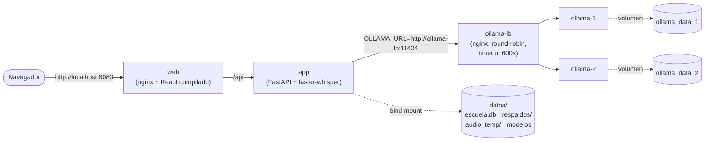
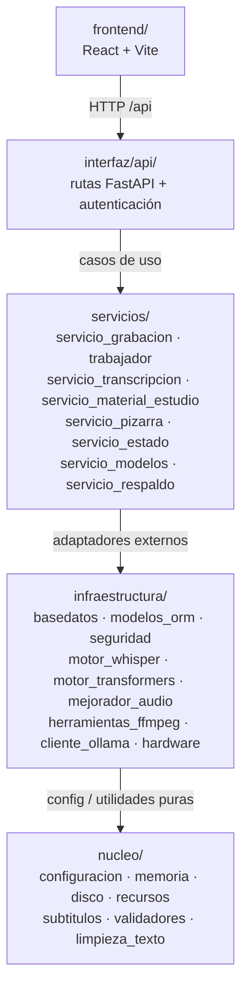
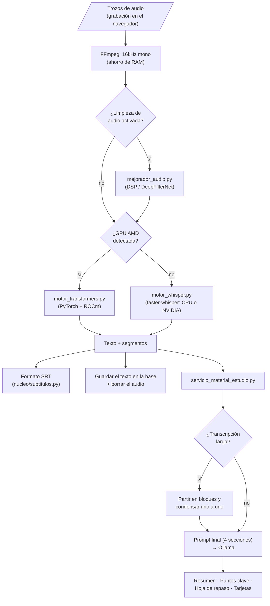

# ClaseAIdia (Universal Local Transcriber)

   

Una aplicación de Inteligencia Artificial alojada localmente, diseñada para transcribir audio y generar material de estudio (resumen y puntos clave) a partir de clases grabadas — pensada para correr en hardware modesto, **sin GPU**, y **completamente offline**.

## Características Principales

* **Transcripción con `faster-whisper` (CTranslate2)**: Motor único, liviano y cuantizado (tiny/base/small) — corre en CPU en tiempo razonable, sin depender de GPU.
* **Filtrado de Audio Avanzado**: Kit de limpieza de ruido integrado por software para purificar el audio antes de transcribir (Filtros auto-ajustables Wiener, Inteligencia Artificial DeepFilterNet local, ecualización y compresores dinámicos).
* **Plataforma para colegios**: horario por curso y bloque, tres roles (UTP, profesor y alumno), grabación de la clase desde el navegador, cola de procesamiento y panel de estado del servidor. Todo guardado en una base SQLite del propio colegio; del audio no queda nada, solo el texto.
* **Post-Procesamiento con LLM**: Conexión directa con *OLLAMA* para generar resumen y puntos clave de la clase con modelos textuales puramente locales.

## Aviso para el colegio: privacidad y condiciones de uso

**Al instalar y usar ClaseAIdia, el colegio acepta estas condiciones.** Como el sistema corre en el servidor del propio colegio, es el colegio quien administra los datos y responde por ellos ante sus alumnos y apoderados.

- **Qué se guarda:** nombre, RUT y curso de cada persona; el PIN de los alumnos y la contraseña del personal solo como hash irreversible (nadie puede leerlos); por cada clase, la transcripción en texto y el material de estudio generado; el horario.
- **Qué no se guarda:** las fotos de la pizarra que saca el profesor tampoco se guardan: se leen con IA en el propio servidor y la imagen se borra al instante (solo queda el texto leído). El audio nunca se almacena de forma permanente: se borra al terminar de procesarse. Si el procesamiento falla, se conserva en el servidor solo mientras queden reintentos automáticos (a los 5, 15 y 45 minutos; unas 65 min como máximo) y se borra al tener éxito o al agotarse los intentos. No hay cookies de seguimiento, publicidad ni analíticas de terceros. Todo el procesamiento de IA ocurre en el servidor del colegio; nada se envía a servicios de IA en la nube.
- **Quién ve qué:** cada alumno ve el material de su propio curso; cada profesor, las clases que dicta; el UTP administra cursos, horarios y personal. Un colegio no ve los datos de otro.
- **Menores de edad:** antes de usar la plataforma con alumnos menores, el colegio debe contar con el **consentimiento informado de sus apoderados**.
- **Material generado por IA:** puede contener errores. Si el profesor no lo revisa en el plazo (24 h por defecto), se muestra a los alumnos marcado como "Sin revisar". El colegio debe informar a profesores y alumnos de esto.
- **Derechos de las personas:** acceso, corrección y eliminación de sus datos (en menores, a través del apoderado). **El colegio define cuánto tiempo conserva las transcripciones** y atiende estas solicitudes.
- **Grabación de clases:** solo con conocimiento del profesor y del curso.
- **Contacto del equipo:** tambotconpatas@proton.me (se muestra en las páginas de privacidad y términos; se cambia en `frontend/.env.production`, variable `VITE_CONTACTO`).

Estas mismas condiciones aparecen dentro de la aplicación (`#/privacidad` y `#/terminos`, enlazadas en el pie de cada pantalla) como respaldo y para consulta de alumnos y apoderados; lo que vale es este aviso. El software se entrega como prototipo académico, sin garantía.

## Instalación

### 0. Versión de Python (3.12 o superior)
Requiere **Python 3.12 o superior** (probado en 3.12 y 3.14). No hace falta Conda ni Anaconda — con el Python normal de [python.org](https://www.python.org/downloads/) (o `winget`) alcanza; el módulo `venv` que se usa abajo es parte de la librería estándar. Versiones anteriores a 3.12 no sirven: `numpy`, `scipy` y `librosa` exigen 3.12 como mínimo.
> **Windows**: `winget install --id Python.Python.3.14 -e --scope user` instala Python sin admin. Si ya tienes otras versiones instaladas, usa `py -3.14` (o la que quieras) en vez de `python` a secas en el paso 2 para apuntar a la correcta.

### 1. Requisitos de FFMPEG (Necesario para procesar audio)
* **Windows**: `winget install Gyan.FFmpeg` o descarga desde [Gyan.dev](https://www.gyan.dev/ffmpeg/builds/) y agrégalo a tu PATH.
* **Mac OS**: Usa Homebrew: `brew install ffmpeg`
* **Linux (Ubuntu)**: `sudo apt install ffmpeg`

### 2. Configuración del Entorno Python
Crea un entorno virtual con `venv` (viene incluido con Python, no requiere instalar nada más) y actívalo:
```bash
python3 -m venv transcriptor-env
# En Linux/Mac:
source transcriptor-env/bin/activate
# En Windows (Powershell) — usa "py -3.14" (o tu versión) si tienes más de una versión de Python instalada:
py -3.14 -m venv transcriptor-env
.\transcriptor-env\Scripts\Activate.ps1
```
*(Si ya usas Conda y prefieres seguir con eso, `conda create -n transcriptor-env python=3.14 -y` funciona igual de bien — ver la [Guía de Instalación en Windows](docs/Guia_Instalacion_Windows.md) para esa variante paso a paso.)*

### 3. Instalación de Dependencias
El hardware objetivo de este proyecto no tiene GPU — `faster-whisper` corre bien en CPU con modelos livianos (tiny/base/small). La app detecta el hardware disponible y elige el motor sola, sin configuración manual:

* **Sin GPU**: instala PyTorch desde el índice **`cpu`** explícito — el índice genérico de PyPI también resuelve a una build con CUDA 13 empaquetado (~1.5GB de paquetes NVIDIA de más, confirmado 2026-09-03) aunque no haya GPU en el equipo:
  ```bash
  pip install torch==2.14.1 torchaudio==2.11.0 --index-url https://download.pytorch.org/whl/cpu
  pip install -r requirements.txt
  ```

* **GPU NVIDIA**: `faster-whisper` (CTranslate2) está compilado contra CUDA 12 — instala PyTorch fijado a ese índice, **no** el genérico (que hoy resuelve a CUDA 13 y causa un error `libcublas.so.12 not found` al transcribir en GPU). `torch` y `torchaudio` deben instalarse del mismo índice en el mismo comando — si quedan de versiones de CUDA distintas, `torchaudio` no encuentra sus propias librerías:
  ```bash
  pip install torch==2.14.1 torchaudio==2.11.0 --index-url https://download.pytorch.org/whl/cu126
  pip install -r requirements.txt
  ```

* **GPU AMD (ROCm, solo Linux)**: `faster-whisper` no puede usar GPUs AMD (CTranslate2 no soporta ROCm), así que la app cae automáticamente a `transformers` + PyTorch, que sí soporta ROCm. Instala el build de PyTorch para ROCm en vez del genérico (ajusta la versión de ROCm a la que tengas instalada, ej. `rocm6.1`):
  ```bash
  pip install torch==2.6.0 torchaudio==2.6.0 --index-url https://download.pytorch.org/whl/rocm6.1
  pip install -r requirements.txt
  ```
  ROCm no está soportado en Windows — ahí una GPU AMD simplemente cae a `faster-whisper` en CPU.

### 4. Opcional: leer la pizarra con una foto

**Está apagada por defecto: cada colegio elige si la quiere** (ver «Rendimiento medido» más abajo para decidir), y lo decide **el UTP dentro de la aplicación**, en «Ajustes» (menú de la izquierda). No hay que editar archivos ni escribir comandos: la aplicación se reparte portable y el colegio no tiene por qué saber hacerlo. La transcripción y el resumen funcionan igual sin ella.

En «Ajustes» el UTP ve lo que necesita para decidir y lo deja listo desde ahí:

- **Memoria del equipo**: dice cuánta tiene y si alcanza (se recomiendan 16 GB; con menos, lo normal es que las fotos se salten solas al procesar y la clase se procese igual, sin ellas).
- **Programa de IA (Ollama)**: si está funcionando en el equipo (Ollama es el único programa que hay que instalar aparte, desde ollama.com).
- **Modelo de lectura de imágenes** (3,2 GB de disco): si falta, un botón «Descargar el modelo» lo baja con una barra de avance. Hace falta internet, una sola vez.
- El interruptor «Permitir fotos de la pizarra». Apagado, el botón no aparece y el servidor rechaza las fotos.

Con ella activada, el profesor puede sacar fotos de la pizarra con su celular durante la clase («Foto de la pizarra» en la pantalla de grabar); un modelo de visión las lee después de la clase y suma lo escrito al material (la imagen se borra apenas se lee). Necesita unos **4,5 GB de memoria libre** además de lo que ya usa el sistema: en un equipo de 16 GB sobra, en uno de 8 GB lo normal es que no alcance. Si el modelo no está instalado, las fotos quedan con un aviso y la clase se procesa igual. Lee bien letra clara, listas y esquemas; en matemática escrita a mano conserva la estructura pero **puede cambiar cifras**, por eso el profesor revisa y corrige antes de aprobar.

### 5. Opcional: modo de limpieza de audio "DeepFilterNet"
`requirements.txt` no incluye `deepfilternet` a propósito — su dependencia `deepfilterlib` compila una extensión nativa en Rust y romper esto rompería la instalación de *todo* el resto de dependencias si Cargo no está presente (confirmado 2026-09-03). Sin este paso, la app funciona igual con los demás modos de limpieza de audio (DSP/MMSE). Para tener el modo `deepfilter` (máxima calidad) también:
```bash
# Requiere Rust + Cargo instalados primero: https://rustup.rs/ (no necesita sudo)
pip install -r requirements-deepfilter.txt
```

## Rendimiento medido (solo CPU, sin GPU)

Lo que sigue se midió con la clase real de 92 minutos (12.500 palabras) y 6 fotos reales de pizarra, por el mismo flujo que usa la aplicación, **solo con CPU**: Ollama y Whisper sin GPU y limitados a los núcleos indicados (2026-10-02). **Las dos partes se miden y se deciden por separado**: lo primero es el núcleo de la aplicación; lo segundo es opcional.

*Advertencia sobre estos números*: se midieron en un procesador Intel Core i5-13420H (de 13.ª generación, rápido). Un PC escolar típico, más antiguo, puede tardar **el doble**. Dos corridas del mismo perfil de 4 núcleos dieron 13,2 y 16,9 minutos de transcripción: cuenten con una variación de un cuarto.

### A. Núcleo: transcripción y resumen (obligatorio)

Una clase de 92 minutos, de principio a fin (la clase se procesa sola después de terminar; una clase de 45 minutos tarda aproximadamente la mitad):

| Equipo (sin GPU) | Transcripción (Whisper `small`) | Resumen con `llama3.2:1b` (el que se usa sin GPU) | **Total con 1B** | Resumen con `llama3.2:3b` (mejor, más pesado) | Total con 3B |
|---|---|---|---|---|---|
| 4 núcleos rápidos | 16,9 min | 2,4 min | **19,3 min** | 17,5 min | 34,4 min |
| 8 núcleos (4 rápidos + 4 lentos) | 22,3 min | 2,3 min | **24,6 min** | 11,6 min | 33,9 min |

- **Memoria**: la transcripción llega a 2,0 GB; Ollama usa unos 1,6 GB con el modelo de 1B y unos 4,8 GB con el de 3B. Se carga un modelo a la vez y se suelta, así que 8 GB bastan con el de 1B; con el de 3B conviene tener 16 GB.
- *Lo del 8 núcleos*: el procesador de las pruebas mezcla 4 núcleos rápidos con 4 lentos, y la transcripción esperaba a los lentos; un PC con 8 núcleos iguales debería ser más rápido que el de 4. No se midió uno.
- Una jornada con varias clases se procesa de a una, en orden: el procesamiento es de varios minutos por clase, no de horas, así que cabe de sobra entre una clase y la siguiente o durante la noche. Esto último es una estimación (no se midió una jornada completa de clases de 45 minutos).

### B. Opcional: fotos de la pizarra

Seis fotos reales (tarea con letra clara, mapa conceptual en pantalla, pizarra de cálculo, cuaderno de límites, direcciones IP, lista de librerías), cada una leída por el modelo de visión `qwen2.5vl:3b`:

| Equipo (sin GPU) | Primera foto (con la carga del modelo) | Las demás | Las 6 fotos | Memoria del modelo |
|---|---|---|---|---|
| 4 núcleos rápidos | 14 s | de 8 a 47 s (mediana 34 s) | **2,7 min** | 3,4 GB |
| 8 núcleos (4 rápidos + 4 lentos) | 19 s | de 8 a 49 s (mediana 42 s) | **3,1 min** | 3,4 GB |

- Se suma **a la clase, después de transcribir**: una clase con 10 fotos tarda unos 6 minutos más. Más núcleos no la aceleran (leer una imagen depende de la velocidad de la memoria, no de cuántos núcleos haya).
- Pide **3,2 GB de disco** (el modelo, que el UTP baja desde «Ajustes») y unos **4,5 GB de memoria libre** además de lo que ya usa el sistema: con 16 GB sobra; con 8 GB casi seguro que no alcanza, y las fotos se saltan solas (la clase se procesa igual, sin ellas).
- Calidad (ver `QA.md`): lee bien letra clara, listas y esquemas; en matemática escrita a mano **puede cambiar cifras**, por eso el profesor revisa y corrige antes de aprobar. Con la pizarra de cálculo más densa el modelo a veces se repite; la aplicación lo limpia y reintenta sola (en estas seis lecturas no hizo falta).

**Para decidir**: si el equipo del colegio tiene 8 GB, o el profesorado no va a usar la pizarra de esa manera, déjenla apagada (es lo normal: no se descarga nada más ni se gasta tiempo). Si tiene 16 GB y quieren que lo escrito en la pizarra llegue al material, el UTP la activa en «Ajustes».

## Uso

ClaseAIdia son dos programas que trabajan juntos: el **backend** (API FastAPI, en la raíz) y la **interfaz web** (React, en `frontend/`). La forma más corta de levantar los dos es el inicio rápido de abajo; los pasos manuales vienen después.

### Inicio rápido (Linux y macOS): `./iniciar.sh`

Hace lo mismo que `iniciar.bat` en Windows: levanta el servidor y la interfaz juntos y abre el navegador en `http://localhost:5173`. Detén todo con Ctrl+C. Variantes: `./iniciar.sh demo` y `./iniciar.sh celular` (igual que abajo). Usa el entorno `transcriptor-env` si existe.

### Inicio rápido (Windows): un solo doble clic

`iniciar.bat` levanta el servidor y la interfaz juntos y abre el navegador en `http://localhost:5173`; se detiene todo con Ctrl+C o cerrando la ventana. Prepara solo lo que falta: el `.env` con su clave de sesión (si no existe), la base de datos al día y las dependencias de la interfaz (la primera vez). Variantes: `iniciar.bat demo` (datos de ejemplo; rehace `escuela_demo.db` en cada arranque y no toca la base real) e `iniciar.bat celular` (https en la red del colegio, para grabar con el celular; crea el certificado si falta). Es para usar y probar la aplicación; el servidor 24/7 del colegio sigue siendo `scripts\windows\instalar_servidor.bat`. Los pasos de abajo son lo mismo hecho a mano.

### Backend (API FastAPI)

```bash
cp .env.example .env    # y completar JWT_SECRET_KEY (el archivo explica cómo generarla)
alembic upgrade head    # crea/actualiza escuela.db (o la base de DATABASE_URL, si está definida)
uvicorn api:app --port 8000
```
La primera vez, el servidor no tiene colegio: se crea junto con su primer UTP con `POST /auth/setup` (la pantalla de primer arranque de la interfaz lo hace; para hacerlo a mano, arranca con `API_DOCS=1` y usa `http://127.0.0.1:8000/docs`, que por defecto no se publica). Después de eso ese endpoint se cierra solo — hacerlo **antes** de exponer el servidor a internet.
Sin `JWT_SECRET_KEY` la API arranca igual, pero con una clave temporal: todas las sesiones se cierran en cada reinicio.

**Grabar clases** (pestaña «Grabar» del profesor): solo desde la red del colegio. Hay dos formas, las dos válidas: un **PC de la sala graba** (abre la app, entra a «Grabar» y pulsa «Grabar con este equipo»; el celular del profesor solo controla), o el **celular graba** él mismo. Para grabar con el celular la app tiene que abrirse por **https** (o `localhost`): los navegadores no dan el micrófono desde `http://192.168...`; en un PC de la sala que abra la app con `localhost` no hay problema. Para abrirla por https en la red del colegio:
```bash
python -m scripts.generar_certificado            # crea certs/cert.pem y certs/key.pem (certs/ no se sube a git)
uvicorn api:app --host 0.0.0.0 --port 8443 --ssl-keyfile certs/key.pem --ssl-certfile certs/cert.pem
cd frontend && npm run dev:https                  # en desarrollo; mismo certificado
```
El certificado es propio: la primera vez, cada celular o PC muestra «conexión no privada» y hay que tocar «Avanzado → continuar». Si la app se abre con una dirección que no estaba al generarlo, hay que volver a correr el comando agregándola (`python -m scripts.generar_certificado 192.168.1.50`). Para generar el material hace falta tener **Ollama** corriendo con el modelo configurado (`ollama pull llama3.2:3b` es el que elige `ollama_model: auto` con GPU; `llama3.2:1b` sin GPU). Si la generación falla, la transcripción se conserva y el profesor puede pulsar «Reintentar» sin volver a grabar.

### Seguridad del acceso

- **Sesiones**: cada sesión (token de 12 h) se cierra sola al cambiar la contraseña o el PIN, resetearlos o desactivar la cuenta, así que una sesión robada deja de servir. Cada persona puede cerrar todas las suyas con `POST /auth/cerrar-sesiones`.
- **Intentos fallidos**: cada cuenta se bloquea tras 5 fallos (1, 2, 4... hasta 60 min). Un RUT que no existe se bloquea exactamente igual, para que la respuesta no delate quién está registrado. Además, una misma dirección con más de 30 fallos en 10 minutos (contra cualquier cuenta o código de curso) queda fuera unos minutos (`INTENTOS_LOGIN_POR_IP`, `VENTANA_LOGIN_MINUTOS`). Los contadores viven en memoria: un reinicio los borra, pero el bloqueo de cada cuenta real queda en la base.
- **Tamaño de lo que se recibe**: un JSON no puede pasar de 1 MB y una subida de audio o de foto, de 20 MB (`413` si se pasa, también cuando el cliente manda el cuerpo por partes sin declarar el largo). Los campos de texto tienen largo máximo (nombres 120, RUT 20, asignatura 100, sala 50...) y los ids o números fuera del rango de la base responden `422` en vez de un error del servidor.
- **Documentación de la API** (`/docs`, `/redoc`, `/openapi.json`): apagada por defecto. `API_DOCS=1` la enciende (`iniciar.sh`/`iniciar.bat` lo hacen en desarrollo).
- **Detrás de un proxy**: el servidor ve la dirección del proxy, no la de quien pide, y la usa para el límite de intentos y para decidir qué es «la red del colegio» (la grabación de clases). Con `CABECERA_IP_CLIENTE=<cabecera>` se le dice en cuál cabecera el proxy escribe la dirección real. El nginx de Docker ya lo hace (`X-IP-Cliente`, siempre sobrescrita). **No lo configures si el servidor se puede alcanzar sin pasar por ese proxy**: cualquiera podría inventar la cabecera.

### Frontend (interfaz web)

```bash
cd frontend && npm install && npm run dev -- --host      # http://localhost:5173
```
Ver [`frontend/README.md`](frontend/README.md). Para probarlo con datos de ejemplo (un colegio con tres cursos, profesores, alumnos y clases en todos los estados):
```bash
python -m scripts.sembrar_demo          # crea escuela_demo.db (no toca escuela.db) y muestra las cuentas
DATABASE_URL=sqlite:///./escuela_demo.db uvicorn api:app --port 8000
```
(La base de demostración se crea de una vez con el modelo actual, sin alembic: si el modelo cambia en el futuro, se vuelve a sembrar.)

**Si un UTP olvida su contraseña**: otro UTP la resetea desde la pestaña Personal (entrega un código de un solo uso). Si es el único UTP, quien administra el servidor la restablece desde la consola: `python -m scripts.restablecer_utp <RUT>` (pide la contraseña nueva; nunca se pasa por la línea de comandos).

### Accesibilidad

La meta es WCAG 2.1 AA. Qué está cubierto: navegación completa con teclado y un enlace «Saltar al contenido»; nombre accesible en todos los botones y campos; avisos para lectores de pantalla al descargar, mover o quitar partes al corregir; foco que acompaña a quien edita; fórmulas dibujadas con MathML además del dibujo; cada diagrama con su versión en lista de texto; respeto de «reducir movimiento» del sistema; PDF con títulos reales y Word con idioma, títulos y texto alternativo en las imágenes. Cada pantalla se revisa con axe-core y hay pruebas automáticas (`npm test`). **Lo que falta probar**: lectores de pantalla reales (NVDA, VoiceOver, TalkBack) y un teléfono físico. Limitación conocida: en el Word las fórmulas van como imagen y su texto alternativo es el LaTeX (un lector de pantalla lo lee tal cual); la versión «con ecuaciones editables» es la más accesible para quien usa Word con lector de pantalla.

### Servidor 24/7 en Windows (arranque automático y recuperación)

El servidor del colegio funciona sin que nadie lo atienda. En la carpeta `scripts\windows\` (no piden administrador):

- `instalar_servidor.bat` (doble clic): deja el servidor arrancando solo cada vez que el usuario inicia sesión en Windows, lo levanta de nuevo si se cae (espera 5 s; si se cae enseguida, espera más cada vez, hasta 5 min), le pide a Windows que no suspenda el equipo mientras corra y fija «nunca suspender ni hibernar» con corriente conectada. Lo deja corriendo en el momento.
- `quitar_servidor.bat`: lo desinstala y detiene el servidor.
- `iniciar_servidor.bat`: lo corre en una ventana, para probar (con el mismo reinicio automático).
- Usa `https` en el puerto 8443 si existe `certs\cert.pem` (ver `scripts.generar_certificado`) y `http` en el 8000 si no. Los registros quedan en `logs\` (rotan a los 10 MB, 5 copias): `supervisor.log` dice cuándo se cayó y se reinició.

Para que el equipo **vuelva solo tras un corte de luz** hacen falta dos ajustes que ningún script puede hacer por ti: (1) en la BIOS/UEFI, «Restore on AC Power Loss / Power On after power failure» = *Power On*; (2) que Windows inicie sesión solo en la cuenta del servidor (`netplwiz`, desmarcar «los usuarios deben escribir su nombre y contraseña»; en un equipo compartido, usa una cuenta dedicada solo para el servidor). Además, si Ollama se cae, el servidor lo vuelve a abrir solo al necesitarlo, y cada día se guarda un respaldo de la base en `respaldos\` (conviene apuntar `CARPETA_RESPALDOS` a otro disco).

### Probar la instalación (prueba de humo)

`scripts\windows\probar_instalacion.bat` (doble clic, o `python -m scripts.prueba_de_humo`) levanta el servidor de verdad en una carpeta temporal —con su propia base creada desde cero con las migraciones, y la salida a un archivo como la deja el supervisor— y procesa una clase de punta a punta. Con el audio de prueba (un tono) comprueba que todo el motor corre hasta la transcripción; con una voz (`--audio clase.wav`) comprueba también que Ollama escribe el material. Avisa si quedó audio guardado y si el equipo tiene algo urgente (disco, memoria, Ollama). Dura de 15 a 60 segundos, no toca la base ni las carpetas del colegio y se puede correr con el servidor encendido. Conviene correrla después de instalar y después de actualizar: las pruebas automáticas no la reemplazan (todas pasaban mientras, en el servidor real, ninguna clase se procesaba).

### Restaurar un respaldo

Cada día se guarda una copia de la base en `respaldos\` (ver «Servidor 24/7»). Para volver a una: apagar el servidor (`scripts\windows\quitar_servidor.bat`), correr `scripts\windows\restaurar_respaldo.bat` (muestra qué hará con el último respaldo, o con el archivo que se arrastre sobre el `.bat`, y pregunta antes) y volver a iniciar el servidor (`instalar_servidor.bat`). Antes de reemplazar nada comprueba que la copia esté íntegra y sea de ClaseAIdia; la base que había **se conserva al lado, con la fecha**; y al terminar aplica las migraciones (un respaldo de una versión anterior queda al día). Se niega a correr con el servidor encendido. Está probado de verdad: se destruyó una base con una clase ya procesada, se restauró, el servidor arrancó sobre ella, la contraseña de antes entró y la clase se veía con su resumen.

### Disco lleno

Con poco espacio libre en el disco donde está el audio, el servidor se protege solo (un disco lleno corrompe la base y pierde clases): con menos de **2 GB** no se puede empezar a grabar una clase nueva (el botón queda desactivado y dice por qué; una grabación que ya está en curso sigue); con menos de **0,3 GB** ni siquiera se acepta más audio (el equipo grabador lo conserva y reintenta, y muestra el motivo); y con menos de **1 GB** no se lanza el procesamiento (se reintenta a los 5, 15 y 45 minutos). El panel «Estado» del UTP avisa antes: desde los 5 GB (aviso) y bajo los 2 GB (urgente).

### Panel de estado (UTP)

El servidor corre sin que nadie lo mire, así que el UTP ve cómo está desde la propia aplicación: «Estado» en el menú (se actualiza solo cada 10 segundos). Arriba salen los **avisos**, con lo urgente primero y en palabras de persona; debajo, **qué clases se están grabando o procesando** (y cuál ya está en marcha o espera su turno), cuáles **fallaron y se reintentan solas** y cuáles **quedaron con error sin reintento**; y el **estado del equipo**: programa de IA (Ollama) y modelo de resúmenes, espacio en disco (con lo que ocupan el audio y las fotos temporales y la base de datos), respaldos (el último, cuántos, en qué carpeta y si están en el mismo disco que la base), memoria y la «vigilancia automática» (la que corta las grabaciones olvidadas y lanza los reintentos).

Avisa cuando: quedan menos de 5 GB en el disco (urgente bajo 2 GB); el último respaldo tiene más de 2 días, o no hay ninguno; los respaldos están en el mismo disco que la base; Ollama no responde o falta el modelo de resúmenes; queda poca memoria (menos de 1,5 GB); la vigilancia dejó de latir (más de un minuto); queda audio guardado sin ninguna clase que lo necesite; o hay clases con error sin reintento. Es solo de lectura: desde ahí no se cambia nada (el profesor reintenta una clase desde «Grabar»).

### Cola de procesamiento

Las clases terminadas se procesan **de a una** (el servidor es un equipo modesto: dos modelos de IA a la vez lo ahogarían), en este orden: primero las marcadas como **prioritarias** (el profesor lo hace con la casilla «Clase prioritaria», durante la clase o mientras la suya espera); luego la de **plazo más cercano** (el plazo de una clase es la próxima vez que se dicta ese mismo bloque según el horario: una semana después, a la misma hora); y a igual plazo, la que se grabó antes. Una clase que ya se está procesando no se interrumpe. El orden se recalcula cada vez que queda un lugar libre, y la cola vive en la base de datos: si el servidor se reinicia, sigue donde estaba. El profesor ve en «Grabar» cuántas clases hay antes que la suya, y el UTP ve toda la cola, en orden, en «Estado». Si un trabajador se cierra por fuera y la clase queda «tomada» sin nadie procesándola, a los 30 segundos se da por perdida y se reintenta sola (5, 15 y 45 minutos, como cualquier otra falla).

Quien administra el servidor puede subir `PROCESAMIENTOS_SIMULTANEOS` (por defecto 1) cuando hay varias instancias de Ollama (el cluster del despliegue con Docker, abajo) y memoria de sobra: cada clase en marcha es un proceso aparte con su propio tope de memoria. Es un ajuste de quien administra, no de la aplicación, a propósito: un colegio con un solo equipo debe dejarlo en 1.

**Con GPU: dejar que Ollama también la use (lo normal).** Si el equipo tiene una GPU, Whisper la usa solo y Ollama también (con el modelo de 3B, más fiel y con mapa conceptual). Se midió, con dos clases de 8 minutos de voz real y una RTX 2050 de 4 GB (ver `QA.md`, «Reparto entre CPU y GPU»): con `PROCESAMIENTOS_SIMULTANEOS=2` y Ollama en la GPU, las dos clases terminan en unos 235 s, contra unos 280 s procesándolas de a una (**15 % menos**), y la memoria de video llegó a 2,7 GB de los 4. Mandar el resumen a la CPU con `OLLAMA_DISPOSITIVO=cpu` **resultó peor**: la CPU con el modelo de 1B tarda más que la GPU con el de 3B (130-160 s contra 85-107 s por clase), dos resúmenes a la vez en la CPU se estorban (no se gana nada: 317 s) y con el modelo de 1B **no se genera el mapa conceptual**. Se deja la opción para equipos cuya GPU no alcance a sostener Whisper y Ollama a la vez, o para dejarla libre para otra cosa; no se recomienda por rendimiento. Una sola corrida de cada escenario salvo los dos principales (repetidos, variaron menos de 4 %), en un equipo de 12 hilos y 24 GB: no es el servidor modesto del colegio.

## Despliegue con Docker (opción alternativa)

Instalación con un solo comando de la aplicación completa, incluyendo un **cluster local de Ollama** (varias instancias en la misma máquina, balanceadas con nginx) para acelerar la generación de material de estudio cuando hay varias clases en cola. **Requiere Docker instalado** (en Windows implica admin + WSL2/Hyper-V) — es una alternativa para colegios con soporte técnico, no reemplaza el objetivo de instalación portátil sin admin (pendiente vía PyInstaller).

Todos los archivos de Docker viven en `docker/` (comandos siempre desde la raíz del repo). Antes del primer arranque hace falta el `.env` (con `JWT_SECRET_KEY`, ver «Backend») y la carpeta de datos, que se crea a mano para que no la cree Docker como `root`:
```bash
cp .env.example .env    # y completar JWT_SECRET_KEY
mkdir -p datos          # base de datos, respaldos, audio temporal y modelos de Whisper
docker compose -f docker/docker-compose.yml up --build
```
Esto levanta:
- `web`: la interfaz (React compilado) servida por nginx en `http://localhost:8080` (cambia el puerto con `PUERTO_WEB`). Reenvía `/api` al backend: es lo único que se publica hacia afuera.
- `app`: el backend (API FastAPI y procesamiento con Whisper). Al arrancar pone la base de datos al día con `alembic`. Lee el mismo `.env` que la instalación sin Docker; la base `escuela.db`, los respaldos y el audio temporal quedan en `datos/`.
- `ollama-1` / `ollama-2`: dos instancias de Ollama (ajustable agregando/quitando bloques en `docker/docker-compose.yml` + `docker/nginx-ollama.conf`, según la RAM disponible — cada instancia carga su propio modelo en memoria), con el modelo configurado descargándose automáticamente al primer arranque.
- `ollama-lb`: balanceador nginx que reparte las peticiones entre las instancias de Ollama.

La primera vez, el servidor no tiene colegio: se crea con su primer UTP como se explica en «Backend» (por ejemplo, con `POST /api/auth/setup`, que desde Docker pasa por nginx).

Por defecto se descarga `llama3.2:1b` (liviano, pensado para CPU — la app elige este mismo modelo automáticamente si `ollama_model` está en `"auto"`). Para usar otro modelo, hay que descargarlo Y decírselo a la app en Configuración:
```bash
OLLAMA_MODEL=qwen2.5:7b docker compose -f docker/docker-compose.yml up --build
```

**https para grabar con el celular**: el navegador del celular solo da acceso al micrófono por https. Crea el certificado y suma el archivo `docker/docker-compose.https.yml` (la interfaz queda en `https://<equipo>:8443`, y el puerto http redirige ahí):
```bash
python -m scripts.generar_certificado
docker compose -f docker/docker-compose.yml -f docker/docker-compose.https.yml up -d --build
```

**SELinux (Fedora, RHEL)**: los montajes del compose llevan la etiqueta `:z`, necesaria para que el contenedor pueda leer `docker/*.conf` y escribir en `datos/`. En Docker sin SELinux se ignora. Si aun así aparece una alerta de SELinux, es esa carpeta sin etiquetar.

**Solo Whisper en la GPU (NVIDIA)**: `docker/docker-compose.gpu-nvidia-whisper.yml` le da la GPU únicamente a `app` y fija `OLLAMA_DISPOSITIVO=cpu`, para transcribir en la GPU y resumir en la CPU. **Midiendo resultó más lento** que dejar que Ollama también use la GPU (ver «Cola de procesamiento»): úsalo solo si tu GPU no sostiene los dos a la vez. Se usa en lugar de `docker-compose.gpu-nvidia.yml`, no junto con él.

**GPU dentro de Docker**: por defecto la imagen usa solo CPU y ningún contenedor tiene acceso a la GPU del host, aunque exista una — hay que habilitarlo explícitamente con un archivo adicional (`docker/docker-compose.gpu-nvidia.yml` o `docker/docker-compose.gpu-amd.yml`; además instalan la versión de PyTorch que corresponde), y para NVIDIA además instalar el NVIDIA Container Toolkit en el host. Ver el detalle paso a paso en `docs/Notas_de_Instalacion.md`.



Cada instancia de Ollama es un contenedor completo con su propio modelo cargado en memoria — el balanceador solo reparte peticiones entre las que ya están levantadas, no coordina memoria entre ellas. Este cluster solo acelera algo con `PROCESAMIENTOS_SIMULTANEOS` mayor que 1 (ver «Cola de procesamiento» más arriba): la cola de la aplicación procesa de a una clase por defecto, y cada instancia extra permite generar el material de una clase más en paralelo (la transcripción con Whisper corre en el contenedor `app` y compite por su CPU o GPU: el cluster acelera la generación, no la transcripción). Falta de la Fase 6 el empaquetado portable (PyInstaller) y el acceso remoto.

### Arquitectura en Capas

El proyecto está organizado en capas, cada una dependiendo solo de las de abajo (`interfaz → servicios → infraestructura → nucleo`). Los nombres de carpetas y archivos están en español — el proyecto es para colegios chilenos, no tiene sentido que el código base asuma inglés:



- `api.py`: Entry point del backend — crea la app FastAPI (`uvicorn api:app`).
- `frontend/`: Interfaz web (React + Vite + Tailwind). Habla con el backend por `/api`.
- `interfaz/api/`: Rutas de la API (colegios, cursos, bloques, usuarios, clases, grabaciones, ajustes, estado) y verificación de roles en el backend.
- `servicios/`: Casos de uso — `servicio_grabacion.py` (sesiones de grabación, cola de procesamiento y reintentos), `trabajador.py` (el proceso que procesa una clase), `servicio_transcripcion.py` (orquesta FFmpeg + limpieza de audio + faster-whisper + SRT), `servicio_material_estudio.py` (prompt de estudio + parsing de la respuesta de Ollama), `servicio_pizarra.py` (fotos de la pizarra), `servicio_estado.py` (panel de estado), `servicio_modelos.py` (descarga de modelos) y `servicio_respaldo.py` (respaldos de la base).
- `infraestructura/`: Adaptadores a sistemas externos — `basedatos.py` y `modelos_orm.py` (SQLAlchemy sobre SQLite, migraciones en `alembic/`), `seguridad.py` (argon2 y JWT), `motor_whisper.py` (faster-whisper, motor por defecto), `motor_transformers.py` (motor alternativo, solo se activa en GPU AMD/ROCm), `hardware.py` (detección de vendor de GPU), `herramientas_ffmpeg.py`, `mejorador_audio.py` (DSP) y `cliente_ollama.py` (HTTP a Ollama).
- `nucleo/`: Configuración (`configuracion.py`) y utilidades puras sin dependencias externas (`subtitulos.py`, `memoria.py`, `disco.py`, `validadores.py`...).
- `scripts/`: Arranque (`iniciar.py`), base de demostración (`sembrar_demo.py`), certificado https, restablecer UTP, restaurar respaldos y prueba de humo. En `scripts/windows/`, la instalación del servidor 24/7 en Windows.

### Flujo de Procesamiento

De principio a fin: cómo una grabación de clase se convierte en transcripción y material de estudio.



---
*Hecho para clases privadas, 100% locales y automatizadas.*
