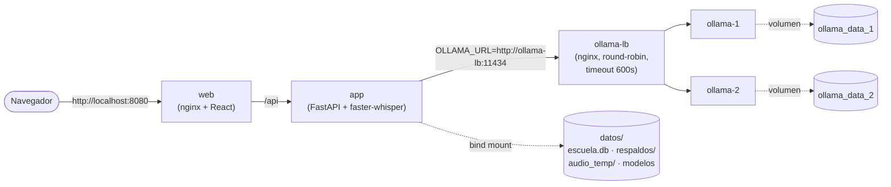

# ClaseAIdia (Universal Local Transcriber)

La aplicación "ClaseAIdia" transcribe audio localmente con `faster-whisper` (CTranslate2) y genera resumen y puntos clave con Ollama — 100% offline, pensada para correr en un PC sin GPU.

Es una aplicación web: un backend FastAPI (`api.py`) y una interfaz React (`frontend/`).

## Notas de Instalación y Entorno

### 0. Versión de Python (3.12 o superior)

Requiere **Python 3.12 o superior** (probado en 3.12 y 3.14). Versiones anteriores no sirven: `numpy`, `scipy` y `librosa` exigen 3.12 como mínimo.
> Para una guía completa paso a paso en Windows con Conda, ver [Guía de Instalación en Windows](Guia_Instalacion_Windows.md).

Si tu sistema operativo trae una versión anterior a 3.12, instala una más nueva de forma aislada para el entorno virtual o utiliza Conda:
*   **Fedora/Nobara**: `sudo dnf install python3.14 python3.14-devel`
*   **Ubuntu/Debian**: `sudo apt install python3.14 python3.14-venv` (si tu versión de Ubuntu aún no la trae, usa 3.12 o el repositorio deadsnakes)
*   **Arch**: `sudo pacman -S python` (trae la versión más reciente)
*   **Windows**: instalar desde [python.org](https://www.python.org/downloads/) además del que ya tengas — el instalador no reemplaza versiones existentes.

### 1. Requerimientos de Sistema Operativo (Dependencias C/C++)

Para que `faster-whisper` pueda procesar MP3, M4A o audio corrompido, necesitas instalar **FFMPEG**.

*   **Linux (Ubuntu/Debian)**: `sudo apt update && sudo apt install ffmpeg`
*   **Linux (Fedora)**: `sudo dnf install ffmpeg` (requiere el repositorio RPM Fusion habilitado: `sudo dnf install https://download1.rpmfusion.org/free/fedora/rpmfusion-free-release-$(rpm -E %fedora).noarch.rpm`)
*   **Linux (CentOS/RHEL)**: habilita EPEL y RPM Fusion primero (`sudo dnf install epel-release`, luego el paquete RPM Fusion equivalente al de Fedora para tu versión de RHEL), después `sudo dnf install ffmpeg`
*   **Linux (Arch)**: `sudo pacman -S ffmpeg`
*   **Mac OS (Homebrew)**: `brew install ffmpeg`
*   **Windows**: `winget install Gyan.FFmpeg` (verificado 2026-09-04 — reinicia la terminal después para que reconozca el PATH nuevo) o manual descargando los binarios y agregándolos a tu variable `PATH`.

### 2. Creación de un Entorno Aislado

```bash
# Python venv (parte de la librería estándar, no requiere Conda) — usa el
# binario 3.12 o superior del paso 0, no "python" a secas si el de tu
# sistema es anterior.
python3 -m venv transcriptor-env
source transcriptor-env/bin/activate
# En Windows powershell — "py -3.14" (o tu versión) si tienes más de una versión de Python instalada:
py -3.14 -m venv transcriptor-env
.\transcriptor-env\Scripts\Activate.ps1
```
En Windows, si no tienes ningún Python 3.12 o superior instalado: `winget install --id Python.Python.3.14 -e --scope user` lo instala sin permisos de administrador (verificado 2026-09-05).

*(Si prefieres Conda, `conda create -n transcriptor-env python=3.14 -y` funciona igual — ver `Guia_Instalacion_Windows.md` para esa variante completa.)*

### 3. PyTorch Base (CPU, NVIDIA o AMD)

El hardware objetivo de este proyecto (PC de sala de colegio) no tiene GPU, así que basta con la build genérica de PyTorch. La app detecta sola el hardware disponible y elige el motor de transcripción correspondiente — no hay que configurar nada manualmente.

**Sin GPU** (usa `faster-whisper` en CPU) — usa el índice **`cpu`** explícito, no el genérico: el índice genérico de PyPI también resuelve a una build con CUDA 13 empaquetado (~1.5GB de paquetes NVIDIA de más que nunca se van a usar sin GPU, confirmado 2026-09-03):
```bash
pip install torch==2.14.1 torchaudio==2.11.0 --index-url https://download.pytorch.org/whl/cpu
```

**GPU NVIDIA** (usa `faster-whisper` en GPU): CTranslate2 está compilado contra CUDA 12 — el índice genérico de pip resuelve a CUDA 13 (`libcublas.so.12 not found` al transcribir), así que hay que fijar el índice a `cu126` (misma versión de PyTorch más reciente, solo cambia la familia de CUDA). `torch` y `torchaudio` van en el mismo comando — si quedan de índices distintos, `torchaudio` no encuentra sus propias librerías:
```bash
pip install torch==2.14.1 torchaudio==2.11.0 --index-url https://download.pytorch.org/whl/cu126
```

**GPU AMD (usa `transformers`, ya que `faster-whisper`/CTranslate2 no soporta ROCm)** — solo Linux, ROCm no está disponible en Windows:
```bash
pip install torch==2.6.0 torchaudio==2.6.0 --index-url https://download.pytorch.org/whl/rocm6.1
```
Ajusta `rocm6.1` a la versión de ROCm que tengas instalada a nivel de sistema. La instalación de los drivers/kernel modules de ROCm es aparte y depende de la distro (sigue la [guía oficial de AMD](https://rocm.docs.amd.com/) para tu caso):
*   **Ubuntu/Debian**: paquetes `.deb` oficiales de AMD, vía su repositorio apt.
*   **Fedora**: soporte oficial de ROCm vía el instalador de AMD para RPM.
*   **CentOS/RHEL**: soportado en las versiones "workstation/server" de RHEL vía el instalador oficial de AMD (revisa la matriz de compatibilidad de ROCm, ya que no todas las versiones de RHEL están cubiertas).
*   **Arch**: paquetes `rocm-hip-sdk` y relacionados disponibles en el repositorio `extra` (`sudo pacman -S rocm-hip-sdk`), mantenidos por la comunidad — no oficiales de AMD.
Si `transformers` no está instalado o el sistema no tiene ROCm configurado, una GPU AMD simplemente cae a `faster-whisper` en CPU (no rompe la app).

### 4. Instalar las Dependencias Finales

Navega a la carpeta de este README e inserta:

```bash
pip install -r requirements.txt
```

`requirements.txt` deja afuera a propósito `deepfilternet` (modo de limpieza de audio "máxima calidad") — su dependencia `deepfilterlib` compila una extensión nativa en Rust, y si Cargo no está instalado rompe la instalación de *todas* las demás dependencias del archivo, no solo la suya (confirmado 2026-09-03). Sin este paso la app funciona igual con los demás modos de limpieza de audio (DSP/MMSE, ver `infraestructura/mejorador_audio.py`). Para tener también el modo `deepfilter`:
```bash
# Requiere Rust + Cargo instalados primero: https://rustup.rs/ (instalación de usuario, no necesita sudo/admin)
pip install -r requirements-deepfilter.txt
```

### 5. Ejecutar la Aplicación.

Teniendo esto listo, la forma más simple es el script de inicio, que prepara el `.env`, la base de datos y las dependencias de la interfaz, y abre el navegador en `http://localhost:5173`:

```bash
./iniciar.sh          # Linux / macOS (en Windows: iniciar.bat)
./iniciar.sh demo     # con datos de ejemplo
```

Para levantar el backend y la interfaz a mano, ver «Uso» en el `README.md`.

### 6. Alternativa: Despliegue con Docker

Si prefieres no instalar Python/FFmpeg/dependencias a mano, `docker compose` levanta todo de una vez, incluyendo un cluster local de Ollama (varias instancias en la misma máquina) para acelerar la generación de material de estudio. **Requiere Docker instalado** — en Windows eso implica permisos de administrador y WSL2/Hyper-V habilitado, así que esta vía es para colegios con soporte técnico disponible, no para el objetivo original de instalación portátil sin admin (ese sigue siendo el ejecutable de PyInstaller, pendiente aparte).

```bash
cp .env.example .env    # y completar JWT_SECRET_KEY
mkdir -p datos
docker compose -f docker/docker-compose.yml up --build
```

El contenedor `app` corre con tu mismo UID/GID de host (`docker/docker-compose.yml` ya lo fija a 1000:1000 por defecto) para que los archivos que genera en `datos/` (base de datos, respaldos, audio temporal) sean tuyos, no de `root` — importante si alguna vez alternas entre correr esto con Docker y correrlo nativo (sin Docker) sobre la misma carpeta. Si tu usuario no es el 1000 (`id -u` para chequear), ajusta con `APP_UID=$(id -u) APP_GID=$(id -g) docker compose -f docker/docker-compose.yml up --build`.

Por defecto se levantan 2 instancias de Ollama (`ollama-1`, `ollama-2`) balanceadas por un contenedor nginx (`ollama-lb`) — ajusta la cantidad agregando o quitando bloques en `docker/docker-compose.yml` y `docker/nginx-ollama.conf` según la RAM disponible en el PC del colegio. Por defecto se descarga `llama3.2:1b` (liviano, pensado para CPU — la app lo elige solo cuando `ollama_model` está en `"auto"`; si hay GPU disponible usa `llama3.2:3b`). Para usar otro modelo hay que descargarlo Y configurarlo en la app:

```bash
OLLAMA_MODEL=qwen2.5:7b docker compose -f docker/docker-compose.yml up --build
```



Ojo: cada réplica de Ollama descarga y carga su propio modelo por separado (no comparten memoria ni disco entre sí) — 2 instancias de un modelo de 7-9B cuantizado significan el doble de RAM y disco que una sola. En un PC realmente modesto, considera dejar solo `ollama-1` (borrando el bloque `ollama-2` de `docker/docker-compose.yml` y la línea correspondiente de `docker/nginx-ollama.conf`) en vez de forzar el cluster.

#### GPU dentro de Docker (paso aparte, requiere `sudo`)

**Por defecto, Docker no le pasa la GPU del host a ningún contenedor** — aunque el PC tenga una NVIDIA o AMD, `app` y los contenedores de Ollama corren en CPU mientras no se configure esto explícitamente. Para producción final en un PC con GPU, hace falta:

**NVIDIA** — instalar el NVIDIA Container Toolkit en el host (una sola vez):
```bash
curl -fsSL https://nvidia.github.io/libnvidia-container/gpgkey | sudo gpg --dearmor -o /usr/share/keyrings/nvidia-container-toolkit-keyring.gpg
curl -s -L https://nvidia.github.io/libnvidia-container/stable/deb/nvidia-container-toolkit.list | \
  sed 's#deb https://#deb [signed-by=/usr/share/keyrings/nvidia-container-toolkit-keyring.gpg] https://#g' | \
  sudo tee /etc/apt/sources.list.d/nvidia-container-toolkit.list
sudo apt-get update
sudo apt-get install -y nvidia-container-toolkit
sudo nvidia-ctk runtime configure --runtime=docker
sudo systemctl restart docker
```
El último paso reinicia el daemon de Docker — tira abajo cualquier contenedor corriendo en ese momento (incluido este proyecto, si estaba levantado). Después de instalar, levanta el stack agregando el archivo `docker-compose.gpu-nvidia.yml`:
```bash
docker compose -f docker/docker-compose.yml -f docker/docker-compose.gpu-nvidia.yml up -d --build
```

**AMD (ROCm)** — requiere los drivers ROCm instalados en el host (ver sección 3 más arriba) y correr con:
```bash
docker compose -f docker/docker-compose.yml -f docker/docker-compose.gpu-amd.yml up -d --build
```

En ambos casos, la app detecta la GPU dentro del contenedor igual que en la instalación nativa: usa el catálogo de modelos grande de faster-whisper (si es NVIDIA con ≥4GB VRAM) o el motor `transformers`/ROCm (si es AMD), y Ollama pasa a `llama3.2:3b` en vez de `llama3.2:1b`.
